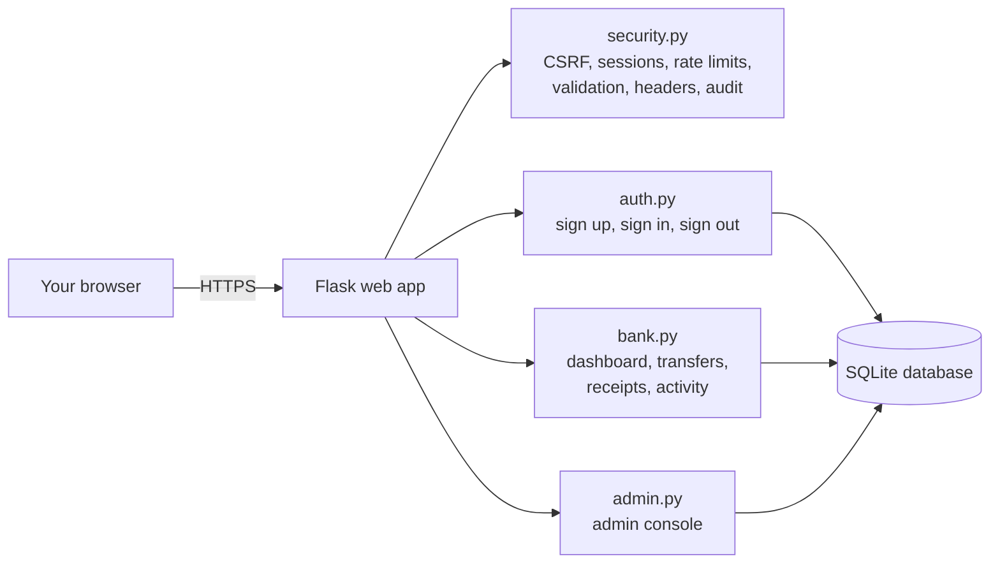
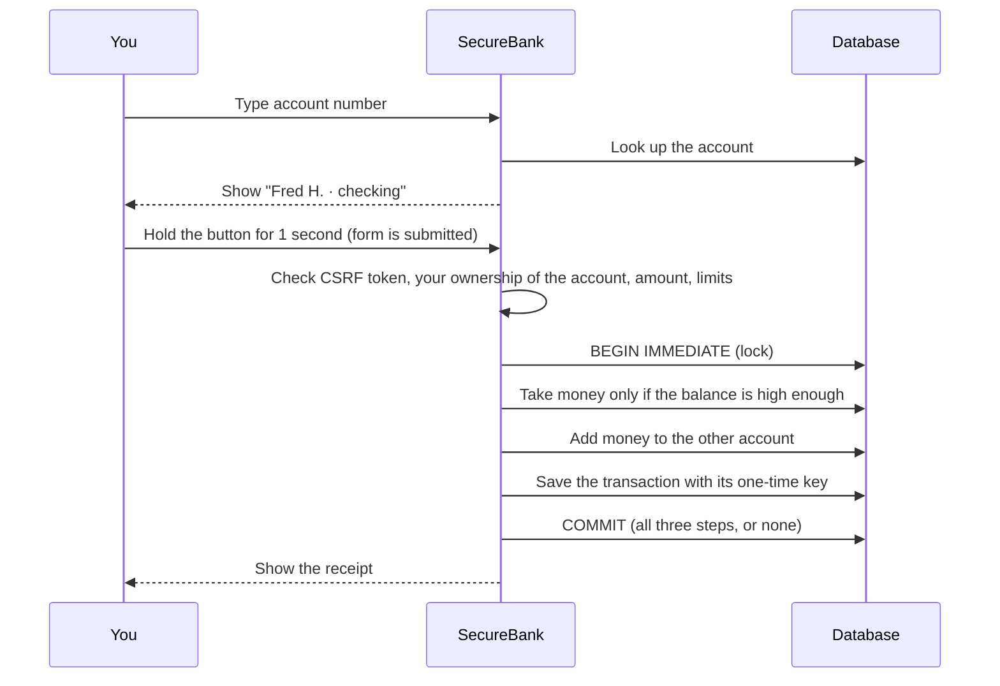

# SecureBank Pro

**A practice online bank that shows how real banks keep your money and your account safe.**

You can open an account, get 5,000.00 in pretend money, send money to other people, move money into savings, and see a receipt for every payment. Behind the scenes, the app uses the same kinds of protection real banks use: hashed passwords, sessions that expire, protection against hackers guessing passwords, and transfers that can never "half happen".

> **No real money is involved.** This is a learning and portfolio project. Every balance is pretend.

Built with **Python, Flask, SQLite and Docker**. Every security feature listed below is written in the code and checked by an automated test.

### 🌐 Live demo: **[securebank-pro.onrender.com](https://securebank-pro.onrender.com)**

Open the link, click **Open a free account**, and try it out. It runs on Render's free plan, so:
- the first visit after a quiet period can take **30–50 seconds** while the server wakes up
- all accounts are **reset** whenever the server restarts, so treat it as a playground

[](https://render.com/deploy?repo=https://github.com/Prashasthi-18/SecureBank-Pro)

---

## Contents

1. [What you can do](#what-you-can-do)
2. [Quick start (run it on your computer)](#quick-start-run-it-on-your-computer)
3. [How to use the app](#how-to-use-the-app)
4. [How it keeps you safe](#how-it-keeps-you-safe)
5. [How it works inside](#how-it-works-inside)
6. [Settings](#settings)
7. [Running the tests](#running-the-tests)
8. [Putting it online](#putting-it-online)
9. [Project structure](#project-structure)
10. [Troubleshooting](#troubleshooting)
11. [Limits and ideas for the future](#limits-and-ideas-for-the-future)

---

## What you can do

**As a customer**

| Feature | What it means |
|---|---|
| Open an account | Sign up with your name, a username, an email and a strong password. You get a **checking** and a **savings** account. |
| Welcome money | Your checking account starts with **5,000.00** so you can try things out. |
| Send money | Pay anyone who has a SecureBank account number (it looks like `SB0123456789`). Before you send, the app shows their name (for example "Fred H.") so you know you have the right person. |
| Move to savings | Move money between your own checking and savings accounts in one click. |
| Receipts | Every payment gets a receipt with a reference number like `SBP-00000042`. You can print it. |
| Activity | See every payment in and out, and filter by "money in", "money out" or "between my accounts". |
| Getting started guide | New users see a 4-step checklist and can take a 30-second guided tour of the dashboard. |

**As an admin**

| Feature | What it means |
|---|---|
| Overview numbers | Number of customers, total money held, failed sign-ins and blocked attacks in the last 24 hours. |
| Freeze an account | Stops a customer from signing in and **signs them out everywhere immediately**. |
| Unlock an account | Lets a customer back in after they were locked out for too many wrong passwords. |
| Audit trail | A timeline of important events: sign-ins, failed attempts, transfers, blocked attacks and admin actions, with the IP address of each. |

---

## Quick start (run it on your computer)

You need **Python 3.12** (or newer). Docker is optional.

### Option A: with Python

**Windows (PowerShell)**

```powershell
cd securebank-pro
python -m venv .venv
.venv\Scripts\Activate.ps1
pip install -r requirements-dev.txt

# Optional but recommended: a fixed secret key and an admin account
$env:SECRET_KEY = python -c "import secrets; print(secrets.token_hex(32))"
$env:ADMIN_USERNAME = "admin"
$env:ADMIN_PASSWORD = "Choose-A-Strong-Pass1!"

python run.py
```

**macOS / Linux**

```bash
cd securebank-pro
python3 -m venv .venv
source .venv/bin/activate
pip install -r requirements-dev.txt

export SECRET_KEY=$(python -c "import secrets; print(secrets.token_hex(32))")
export ADMIN_USERNAME=admin
export ADMIN_PASSWORD='Choose-A-Strong-Pass1!'

python run.py
```

Then open **http://127.0.0.1:5000** in your browser.

> If you skip `SECRET_KEY`, the app makes a random one each time it starts, so you'll be signed out whenever you restart it. If you skip `ADMIN_PASSWORD`, no admin account is created.

### Option B: with Docker

```bash
cp .env.example .env        # Windows: Copy-Item .env.example .env
# Open .env and change SECRET_KEY and ADMIN_PASSWORD
docker compose up --build
```

Then open **http://localhost:8000**. Your data is kept in a Docker volume, so it survives restarts.

---

## How to use the app

1. **Open an account.** Click **Open a free account**. Fill in the form. A progress bar and green ticks show you which fields are done, and a checklist shows what your password still needs.
2. **Sign in** with your username and password.
3. **Look around.** The dashboard shows your total balance, a balance chart, your two account cards and your recent activity. Click **Take a 30-second tour** if you want a guided walkthrough.
4. **Send money.** Click **Send money**:
   1. Pick the account to send **from** (checking or savings).
   2. Type the other person's **account number**. Their name appears in green when it's found. To move money between your own accounts, click **My savings** or **My checking** instead.
   3. Type an **amount** (or click a quick pick like 50 or 100) and an optional note.
   4. **Press and hold** the button for one second. Holding the button stops accidental taps from sending money.
5. **See your receipt.** You'll see a confirmation with all the details. Click **Print** if you want a copy.
6. **Sign out** with the button at the top right. If you do nothing for 10 minutes, you're signed out automatically. The ring next to the clock shows how much time is left, and you get a warning one minute before.

> **Tip:** to try sending money to someone else, open a second account in a private/incognito window, then copy its account number with **Copy my number**.

---

## How it keeps you safe

Each protection below is explained in plain words. The last column links it to the [OWASP Top 10](https://owasp.org/Top10/), the standard list of the most common web security risks.

| Risk | What could go wrong | How SecureBank Pro stops it | OWASP |
|---|---|---|---|
| **Stolen passwords** | If the database leaked, attackers could read passwords. | Passwords are never stored. Only a salted **scrypt hash** is saved, which can't be turned back into the password. Passwords must be 12+ characters with upper and lower case, a number and a symbol, and can't contain your username. | A02, A07 |
| **Password guessing** | A bot tries thousands of passwords. | After **5 wrong passwords** the account locks for **15 minutes**. Each IP address is also limited to 10 sign-in attempts a minute and 5 sign-ups every 5 minutes. | A07 |
| **Finding out who has an account** | An attacker checks which usernames exist. | "Unknown user" and "wrong password" show the **same message** and take the same time to answer. Sign-up doesn't reveal whether a username or email is already taken. | A07 |
| **Stolen session cookies** | Someone copies your login cookie. | Cookies can't be read by JavaScript (HttpOnly), are never sent from other sites (SameSite=Strict), only travel over HTTPS when deployed (Secure), last **15 minutes** at most and expire after **10 idle minutes**. | A07 |
| **Session fixation** | An attacker plants a session ID before you sign in. | The session is wiped and replaced every time you sign in. | A07 |
| **Signing out doesn't really sign out** | Old copies of a cookie keep working. | Each user has a `session_version`. Signing out, or an admin freezing the account, bumps it, and every old cookie stops working instantly. | A07 |
| **Fake requests from other sites (CSRF)** | A malicious site makes your browser send money. | Every form carries a secret token that's checked on every submission, plus SameSite=Strict cookies. | A01 |
| **Seeing other people's data (IDOR)** | Changing a number in the URL shows someone else's receipt. | Every query only looks at the signed-in user's accounts. Other people's receipts return "not found" rather than "forbidden", so attackers can't even tell they exist. | A01 |
| **Customers reaching admin pages** | A normal user opens the admin console. | `login_required` and `role_required("admin")` checks guard every page. | A01 |
| **Redirect tricks** | A link signs you in, then sends you to a fake site. | After sign-in the app only redirects to pages on its own site. | A01 |
| **SQL injection** | Typing database commands into a form. | Every database query uses parameters, never pasted-together text. | A03 |
| **Cross-site scripting (XSS)** | Someone puts `<script>` in a transfer note. | All output is escaped automatically, and a strict **Content Security Policy** blocks inline scripts and styles, framing and plugins. | A03 |
| **Money appearing or vanishing** | Rounding errors, or two transfers at once spending the same money. | Money is stored as **whole cents** (never decimals). Each transfer runs inside a database write lock, the debit only succeeds if the balance is high enough, and the database itself refuses negative balances. The debit, the credit and the record of the transfer are saved together or not at all. | A04 |
| **Paying twice** | Double-clicking or refreshing resends a payment. | Each transfer form has a one-time key. A second submission is rejected. | A04 |
| **Very large transfers** | A stolen account is emptied at once. | At most **10,000.00 per transfer** and **25,000.00 per day** to other people. | A04 |
| **Bad input** | Strange characters or huge requests break things. | Names, usernames, emails, account numbers and amounts are checked against strict patterns. Control characters are removed from notes, and requests over 16 KB are rejected. | A03, A04 |
| **Browser-level attacks** | Clickjacking, content sniffing, cached balances. | Security headers: HSTS, X-Frame-Options, nosniff, Referrer-Policy, Permissions-Policy and Cross-Origin-Opener-Policy. Signed-in pages are never cached. | A05 |
| **Attacks nobody notices** | Break-in attempts leave no trace. | An **audit log** records sign-ins, failures, lockouts, transfers, blocked attacks and admin actions, with the IP address. | A09 |
| **A hacked server** | An attacker who gets in can do anything. | The Docker container runs as a non-root user on a read-only filesystem, with all Linux capabilities removed. | A05 |

---

## How it works inside

### The big picture



Every request first passes through `security.py`, which loads the signed-in user, checks the CSRF token and later adds the security headers. Then the right page handler runs.

### What happens when you send money



### The database

There are four tables (see [`app/schema.sql`](app/schema.sql)):

| Table | What it stores |
|---|---|
| `users` | Name, username, email, password hash, role (`customer` or `admin`), failed sign-in count, lock time, frozen flag, session version. |
| `accounts` | Each checking or savings account: its owner, its number (`SB` + 10 digits) and its balance in cents. Balances can't go below zero. |
| `transactions` | Every deposit and transfer: from, to, amount in cents, note, time and the one-time key that blocks double payments. |
| `audit_log` | Security events with the user, a description and the IP address. |

### Pages and addresses

| Address | What it is | Who can use it |
|---|---|---|
| `/` | Home page | Everyone (signed-in users go to the dashboard) |
| `/register` | Open an account | Everyone |
| `/login` | Sign in | Everyone |
| `/logout` | Sign out (form button) | Signed-in users |
| `/dashboard` | Balances, chart, accounts, recent activity | Signed-in users |
| `/transfer` | Send money | Signed-in users |
| `/transfers/<id>` | A receipt | Only the sender or receiver |
| `/activity` | Full payment history, 15 per page | Signed-in users |
| `/api/lookup?account=SB…` | Checks an account number and returns the masked name (20 lookups a minute per user) | Signed-in users |
| `/admin/` | Admin console | Admins only |
| `/admin/users/<id>/freeze` | Freeze or unfreeze a customer | Admins only |
| `/admin/users/<id>/unlock` | Clear a lockout | Admins only |

### The interface

The design is a dark, modern banking style with smooth animation. Everything runs under the strict security policy above: there are no inline scripts or styles anywhere.

- **Animated background**: slowly drifting colours and a soft glow that follows your cursor.
- **Home page**: the headline appears word by word, with a floating preview of the dashboard that moves as you move the mouse.
- **Sign-in**: a padlock reacts as you type, shakes on a wrong password and unlocks when you sign in.
- **Dashboard**: balances roll into place like a car odometer, the chart draws itself and shows values on hover, and the account cards tilt in 3D.
- **Receipts**: a check mark draws itself, coins fly from sender to receiver, and confetti bursts.
- **Phones**: a bottom tab bar with a large Send button.
- **Accessibility**: if your device has "reduce motion" turned on, all animation switches off. Every form field has a label, and everything works with the keyboard.

---

## Settings

The app is configured with environment variables. [`.env.example`](.env.example) lists them all.

| Variable | Default | What it does |
|---|---|---|
| `SECRET_KEY` | random on each start | Signs the session cookies. **Set a long random value** in any real deployment. |
| `COOKIE_SECURE` | `false` | Set to `true` when the site uses HTTPS. Adds the Secure cookie flag and the HSTS header. |
| `BEHIND_PROXY` | `false` | Set to `true` only when the app runs behind one trusted proxy (such as Render), so it sees each visitor's real IP address. Leave it `false` otherwise, or visitors could fake their IP. |
| `SESSION_MINUTES` | `15` | The longest a sign-in lasts. |
| `IDLE_TIMEOUT_SECONDS` | `600` | Sign out after this many seconds without activity. |
| `ADMIN_USERNAME` | not set | If this and `ADMIN_PASSWORD` are both set, an admin account is created the first time the app starts. |
| `ADMIN_PASSWORD` | not set | The admin's password. **Change the example value before you use it.** |
| `DATABASE_PATH` | `instance/securebank.db` | Where the SQLite file is saved (`/data/securebank.db` in Docker). |

These limits are set in [`app/config.py`](app/config.py):

| Limit | Value |
|---|---|
| Welcome deposit | 5,000.00 |
| Largest single transfer | 10,000.00 |
| Daily limit to other people | 25,000.00 |
| Wrong passwords before lockout | 5 |
| Lockout length | 15 minutes |

---

## Running the tests

There are **39 automated tests**: 35 that check the code directly and 4 that drive a real browser.

```bash
pytest -m "not e2e"          # 35 tests: sign-in, security and transfers
playwright install chromium  # one-time download of a test browser
pytest -m e2e                # 4 browser tests
pytest --cov=app             # shows how much of the code the tests cover
```

| File | What it checks |
|---|---|
| `tests/test_auth.py` | Two accounts and the welcome deposit on sign-up, password hashing, weak passwords, duplicate usernames, identical error messages, lockout after 5 failures, a new session on sign-in, stolen cookies dying on sign-out, safe redirects |
| `tests/test_security.py` | CSRF tokens, security headers, cookie flags, no caching, pages that need sign-in, admin-only pages, freezing, idle timeout, SQL injection, sign-in rate limit, oversized requests |
| `tests/test_transfers.py` | All-or-nothing transfers, insufficient money, invalid amounts, spending from someone else's account, viewing someone else's receipt, double payments, per-transfer and daily limits, sending to the same account, XSS in notes, masked name lookup |
| `tests/test_e2e.py` | In a real browser: the password checklist, hold-to-send, the move-to-savings shortcut and wrong-password messages. It also checks that the security policy is never broken. |

---

## Putting it online

### Render (easiest)

1. Click the **Deploy to Render** button at the top of this page and sign in with GitHub.
2. Enter an `ADMIN_PASSWORD` when asked, or leave it empty for no admin account.
3. Click **Apply**. After a few minutes your site is live at an address like `https://securebank-pro.onrender.com`.

[`render.yaml`](render.yaml) sets everything else up: it builds the Docker image, generates a `SECRET_KEY`, and turns on secure cookies, HSTS and real visitor IPs. Every push to GitHub redeploys automatically.

> **Free plan notes:** the database lives inside the container, so all accounts are **reset** whenever the site restarts or redeploys. The site also sleeps after 15 minutes without visitors, and the first visit afterwards takes about 30–50 seconds. To keep data, use a paid plan and add a disk mounted at `/data`.

### Any other host

Anything that runs Docker will work. The container listens on the `PORT` environment variable (8000 by default), runs Gunicorn with one worker and 8 threads, and stores data in `/data`. Put it behind HTTPS and set `COOKIE_SECURE=true`.

---

## Project structure

```
securebank-pro/
├── app/
│   ├── __init__.py        Creates the app, error pages, per-request setup
│   ├── config.py          Settings and limits (read from environment variables)
│   ├── db.py              Database connection, setup, new users and accounts
│   ├── schema.sql         Database tables and rules
│   ├── security.py        CSRF, sessions, roles, rate limiter, input checks, headers, audit log
│   ├── auth.py            Sign up, sign in, sign out
│   ├── bank.py            Dashboard, transfers, receipts, activity, account lookup
│   ├── admin.py           Admin console, freeze and unlock
│   ├── templates/         HTML pages (Jinja); _icons.html holds the icon set
│   └── static/
│       ├── css/style.css  The whole visual design
│       └── js/fx.js       Animations, live checks, the tour, hold-to-send
├── tests/                 Automated tests (pytest + Playwright)
├── run.py                 Starts the app
├── Dockerfile             Builds the secure container image
├── docker-compose.yml     Runs the container locally with a data volume
├── render.yaml            One-click deployment settings for Render
├── requirements.txt       Packages the app needs
├── requirements-dev.txt   Extra packages for testing
└── .env.example           Example settings to copy into .env
```

---

## Troubleshooting

| Problem | Fix |
|---|---|
| `Activate.ps1 cannot be loaded` on Windows | Run `Set-ExecutionPolicy -Scope CurrentUser RemoteSigned` once, then try again. |
| I'm signed out every time I restart the app | Set `SECRET_KEY` to a fixed value (see [Quick start](#quick-start-run-it-on-your-computer)). |
| There's no admin account | Set both `ADMIN_USERNAME` and `ADMIN_PASSWORD` before the **first** start. If the database already exists, delete `instance/securebank.db` and start again. |
| The page still looks old after an update | Press **Ctrl+F5** (or **Cmd+Shift+R** on Mac) to reload without the browser's cache. |
| "Account locked" | Wait 15 minutes, or ask an admin to click **Unlock** in the admin console. |
| Sign-in doesn't stick on a deployed site | Make sure the site uses `https://` when `COOKIE_SECURE=true`. |
| Clicking "Send" doesn't send | That's on purpose: **press and hold** the button for one second. |

---

## Limits and ideas for the future

**Current limits**
- The rate limiter keeps its counts in memory, so the app runs as a single process. To run several copies, the counts would need to move to a shared store such as Redis.
- SQLite is great for a single server. A larger deployment would move to PostgreSQL.

**Ideas for next steps**
- Two-factor sign-in with an authenticator app
- Changing your password (and signing out other devices when you do)
- Email alerts for sign-ins from new devices
- Scheduled and recurring transfers
- Light mode
